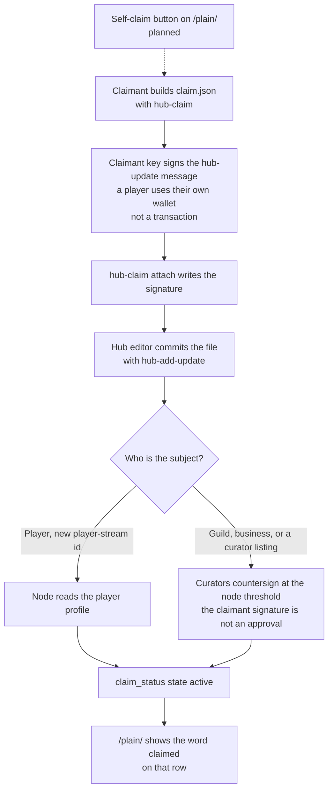

# Claim and verify a listing

This page is the operator and player guide, and the record spec. A person can follow the steps. An agent can follow the same steps and the field list.

The node stays read-only. It does not add a signer, hold a key, or run a new hosted service. A player's claim is signed in the player's own wallet. Curators publish the signed file into the hub repository the same way they publish any other hub update.

## What a claim does

A claim binds one wallet to one listing identity:

- a business or player listing, by its `listingId`
- a guild, by its name
- a new listing id that is not in the hub yet

After the claim is active, updates signed by that wallet for that identity are accepted even though the wallet is not in `hub/signers.json`. The node checks this in `claimantListingAdmission` and `claimantGuildAdmission` (`src/hub/claim.ts`).

On a listing, after the first published version, a claimant may change `offerText`, a hub-relative `image`, `status` (including `withdrawn`), `asOf`, and `expiresAt`. A business claimant may also change `url`. A player claimant may not change `url`. A player claimant may not publish a listing whose `stream` is anything other than `player`, including on the first version.

On a guild, after the first published version, a claimant may change `description`, `links`, `site`, `discord`, a hub-relative `image`, and `withdrawn`. The claimant may not change `name` or `tags`.

An external `https` image is rejected for a claimant. The logo has to be a path inside the hub repository.

A claimant cannot:

- edit a different identity
- edit `hub/signers.json`, thresholds, or signer sets
- sign someone else's claim into force
- change a listing's title, owner, stream, category, disclosure, `verifyLiveNote`, ownership proof, or `listingId` after the first published version

Curator listings stay as they are until a claim is active. After that, the claimant's update wins for that identity, even if a curator publishes a later update (`contentPicks` in `src/hub/claim-resolve.ts`). A threshold revoke, or a revoke signed by the claimant, makes the claim inactive and the curator version shows again. A `withdrawn` update from the claimant, while the claim is still active, hides the row. It does not put the curator version back.

## Squatting rules

These rules are what keep an unbound signature from taking a name.

| Who | What they can claim | When it becomes active |
|---|---|---|
| Player | A **new** `listingId` on the `player` stream | The wallet is the unexpired auth key on the named player profile (slot 0, or a later key with Player Profile AUTH). One profile backs one identity |
| Player | Any other stream, or a listing id a curator published anywhere in the chain | Only if curators countersign. A player-authored listing update is still accepted only when `stream` is `player`, and `url` cannot change after the first published version |
| Guild | A guild name, new or already listed | Only if curators countersign |
| Business | A `listingId`, new or already listed | Only if curators countersign |

The profile program is `pprofELXjL5Kck7Jn5hCpwAL82DpTkSYBENzahVtbc9` (`PLAYER_PROFILE_PROGRAM_ID` in `src/legacy/programs.ts`). A negative expiry does not expire. One profile read looks at most 32 keys (`PROFILE_KEY_SCAN_MAX`). Slot 0 counts when it is unexpired. A later key counts only when its scope is the Player Profile program and the AUTH bit is set. A key that is only a game-scoped key does not match. If the account has more than 32 keys and the wallet is not in the scanned keys, the read is incomplete.

A separate cap, `PROFILE_CHECK_CAP`, is 32 profile reads for one claim resolution. That budget is spent on claims that could still win. A read that cannot be completed leaves the claim `pending_profile` and holds the identity, so the next claimant does not inherit it unless curators countersign. The claim profile budget is separate from `player_legacy`.

X and Discord fields on the claim are **self-attested, unverified**. They do not activate a guild or a business. A curator who accepts them does so by countersigning the claim.

One wallet keeps one identity (`wallet_cap`). One player profile backs one identity only after that wallet matched the profile (`profile_cap`). Only a claim that names this hub, has not expired, and is not revoked counts toward the wallet cap, so an expired or replayed claim does not lock the wallet. The first 64 such claims are considered (`CLAIM_RESOLVE_CAP`). Later ones stay `over_cap` and do not become active.

The first eligible claim in hub-chain order wins. Curators can name a different eligible claim with a threshold `resolve`, or drop one with `revoke`.

A claim whose `hubId` is a different repository does not count, even if the signature is valid. An expired claim does not count. The next eligible claim can then win.

## Player steps

1. Pick a new `listingId` that no curator listing uses. Example: `booth-north`.
2. Build the unsigned claim. The hub id is the normalized repository URL, such as `https://github.com/owner/repo`.

```bash
npm run hub-claim -- build \
  --wallet <claimant address> \
  --hub https://github.com/owner/repo \
  --subject player \
  --listing-id booth-north \
  --profile <player profile account> \
  --nonce booth-north-1 \
  --expires 2027-04-01T00:00:00.000Z \
  --out claim.json
```

3. Sign the `message.utf8` text in the wallet (Phantom's sign-message on those exact bytes). Do not sign a transaction.
4. Attach the signature. This command does not read a key.

```bash
npm run hub-claim -- attach \
  --payload claim.json \
  --public-key <claimant address> \
  --signature <wallet signature> \
  --out claim.signed.json
```

5. Ask a hub editor to add `claim.signed.json` with `npm run hub-add-update -- --store <dir> --payload claim.signed.json`. That records the claim. It does not add the wallet to the allowlist.
6. Publish listing updates the same way, with the claimant as `author`, for that `listingId` only. The first one may set the required listing fields, including `url`. Later ones may change `offerText`, a hub-relative `image`, `status` (including `withdrawn`), `asOf`, and `expiresAt`. They may not change `url`, title, owner, stream, category, disclosure, `verifyLiveNote`, or ownership proof. `stream` stays `player`.

`--key-path` on `hub-claim sign` is only for a local test key. Do not point it at a funded wallet.

## Guild and business steps

Same build command, with `--subject guild --guild-name "east hall"` or `--subject business --listing-id booth-north`.

The claim is not active until curators add approval signatures with the existing approval flow (`npm run sign-hub-update -- --approve`). The number of approvals is the node's threshold. The claimant's own signature is not an approval.

Optional notes a curator can read before countersigning:

- `--x-handle <handle> --x-proof https://x.com/<handle>/status/<id>`
- `--discord-note <short note> --discord-invite https://discord.gg/<code>`
- `--show-handles` if the subject wants the handle shown on `claim_status`

Without `--show-handles`, public claim status does not include the raw handle.

## What the plain page shows

A current listing, guild, or search row with an active claim shows the word `claimed` (`dashboard/plain/plain.js`). The page does not add a wallet address for that badge. X and Discord handles are not printed there.

There is no self-claim button on `/plain/`. Signing happens with the claimant's own key (for a player, their wallet), on their own machine, with the commands on this page. A hub editor then commits the file. A button on the page is planned. It is not in v1.0.0.



## What `claim_status` returns

`claim_status` with no argument lists every claim. `identity` may be a listing id, a guild name, `id:<listingId>`, or `guild:<normalized name>`.

`state` is one of: `active`, `pending_countersign`, `pending_profile`, `profile_mismatch`, `needs_profile`, `expired`, `revoked`, `superseded`, `hub_mismatch`, `wallet_cap`, `profile_cap`, `over_cap`, `unclaimed` (`CLAIM_STATES` in `src/hub/claim-resolve.ts`). `profile_cap` means that player profile already backs another identity, and only after the wallet matched the profile.

`discord` and `x` are `verified`, `self-attested, unverified`, `expired`, `revoked`, or `absent`.

`profile` is `match`, `mismatch`, `unavailable`, or `absent`. A profile read that fails or is rate-limited is `unavailable`, and the claim does not become active.

## Record: `claim`

Hub update kind `claim`. The author signs the usual hub message:

```text
sa-ecosystem-node:hub-update:v1
<canonical JSON of the payload>
```

The canonical JSON includes `claim.nonce`, `claim.hubId`, and `claim.expiresAt`. That is the domain separator, the nonce, the hub id, and the expiry. `signature` is not inside the canonical JSON.

```json
{
  "action": "claim",
  "wallet": "<claimant address>",
  "hubId": "https://github.com/owner/repo",
  "nonce": "booth-north-1",
  "expiresAt": "2027-04-01T00:00:00.000Z",
  "subject": "player",
  "identity": { "type": "listing", "listingId": "booth-north" },
  "playerProfile": "<profile account>"
}
```

Guild identity is `{ "type": "guild", "name": "east hall" }`. `subject` is `player`, `guild`, or `business`. A player or business uses a listing identity. A guild uses a guild identity.

On `action: "claim"`, `author` must equal `wallet`. Optional `x` is `{ "handle", "proofUrl" }`. Optional `discord` is `{ "note", "handle"?, "invite"? }`. `showHandles: true` opts in to showing handles. Unknown fields are rejected.

`action: "revoke"` sets `targetId` to the claim's update id. The subject wallet may sign it, or curators may sign it at threshold. A subject cannot revoke a claim that belongs to someone else.

`action: "resolve"` sets `resolveId` to the claim that should win. Only a threshold of allowlisted signers can resolve. The named claim must already be eligible.

## Record: `attestation`

Hub update kind `attestation`. The author is the verifier's public key. Any node that reads this hub sees the same attestation. A node shows it as `verified` only when that author is in `HUB_TRUSTED_VERIFIERS`. Otherwise it stays `self-attested, unverified`. An empty verifier list is the default, so a stock node still runs on wallet plus Player Profile alone.

```json
{
  "action": "attest",
  "wallet": "<subject wallet>",
  "hubId": "https://github.com/owner/repo",
  "nonce": "attest-1",
  "issuedAt": "2026-10-31T00:00:00.000Z",
  "expiresAt": "2027-04-01T00:00:00.000Z",
  "method": "discord",
  "verifierId": "dock-verifier",
  "handleCommitment": "<64 hex chars>"
}
```

`handleCommitment` is the sha256 hex of the UTF-8 text `salt:` plus the normalized account (`handleCommitment` in `src/hub/attestation.ts`). For Discord, that account is the identify id or username from the proof. For X, it is the lowercase handle. The salt is not stored in the hub, so a public repo is not a list of raw Discord ids. `method` is `discord` or `x`. A raw `handle` is optional and is rejected unless an earlier claim by that wallet set `showHandles`. `claim_status` returns a handle only in that case, and only from the claim or from a current trusted attestation. `hub_updates` does not return claim or attestation records, so it does not return those handles. A Discord snowflake is not a handle. `claim_status` includes `wallet` only while the claim is `active`.

`action: "revoke"` names `targetId` and omits the commitment. It counts when the verifier who issued the attestation signs it, the subject wallet signs it, or allowlisted signers meet the threshold. An expired or revoked attestation is not `verified`. An attestation for another hub, or for a different wallet, does not verify this claim.

## Operator: trusted verifiers

```bash
HUB_TRUSTED_VERIFIERS=<verifier address>
```

Or `hub.trustedVerifiers` in `node.config.json`. Same shape as `HUB_REVOKED_SIGNERS`: a comma-separated list or a JSON array of Solana addresses. Share this list across nodes that should show the same verified badge. The attestation file itself does not change from node to node.

## Operator: optional Discord verifier

This module is not part of the public server. Leave the variables unset and nothing changes.

1. Create a Discord application and a redirect URL on your own machine, such as `http://127.0.0.1:8788/discord`.
2. Set `DISCORD_CLIENT_ID`, `DISCORD_CLIENT_SECRET`, and `DISCORD_REDIRECT_URI` together. Do not commit the secret.
3. The authorize URL asks for the `identify` scope only.

```bash
npm run hub-attest -- discord-url --wallet <subject> --nonce <nonce>
npm run hub-attest -- discord-code --code <code> --state <state> --wallet <subject> --nonce <nonce> --out proof.json
npm run hub-attest -- build --proof-file proof.json --wallet <subject> --nonce <nonce> ...
```

`discord-url` binds the OAuth state to that wallet and nonce. `discord-code` checks the state matches, then writes a proof file with the verified account id and the salt. `build` refuses to run without that proof file. A raw Discord id is not a public handle. `--show-handle` is ignored for a numeric Discord id. The subject's claim must already have set `showHandles` or the node rejects an attestation that includes a handle.

## Operator: X posted-code proof

There is no X API key in this repo. The verifier gives the subject a code. The subject posts it from their account. The operator checks the public status URL:

```bash
npm run hub-attest -- x-check --post https://x.com/<handle>/status/<id> --code <code> --account <handle> --wallet <subject> --nonce <nonce> --out proof.json
```

The status URL path handle must be `--account`, and the final URL after redirects must still be that status URL. If the public page does not include the code, the check fails and no proof is written. Pass `proof.json` to `build --proof-file`. A later version can use the X API on the operator's own key. That key stays out of this repository.

## Verify locally

```bash
npm run hub-claim -- verify --file claim.signed.json --hub https://github.com/owner/repo
npm run hub-attest -- verify --file attest.signed.json --hub https://github.com/owner/repo
```

Local verify checks the signature and, with `--hub`, the hub id. The node still applies expiry, profile, countersign, and verifier trust when it reads the chain.

## Abuse cases the node refuses

- A claim that names someone else's player profile, when the wallet is not a key on it
- A player claim on a listing a curator already published, without a countersign
- A guild or business claim with no countersign
- A claim or attestation copied onto another hub
- An expired claim or attestation
- A claimant editing another identity, or a signer-change
- A second identity for the same wallet
- A forged attestation signature
- An attestation from a verifier this node does not trust (it stays self-attested)
- A revoked attestation, including a revoke by the verifier, the subject, or threshold signers
- An attestation whose wallet is not the claimant

## Planned, not built

These are not in v1.0.0. The commands and the `claim_status` tool on this page are built.

- A self-claim button on `/plain/`. The page shows the word `claimed`. It does not collect a wallet signature.
- A submit route that accepts a claim without a hub editor committing the file. `POST /submit` on the Node server is 404. `submit_hub_update` is not an MCP tool.
- An on-chain anchor for a claim. The claim counts when it is in the pinned hub commit and the rules on this page pass.
- Council or Squads as the countersign authority. Today a countersign is the node's allowlisted approval threshold (`npm run sign-hub-update -- --approve`). The claimant's own signature is not that approval.
