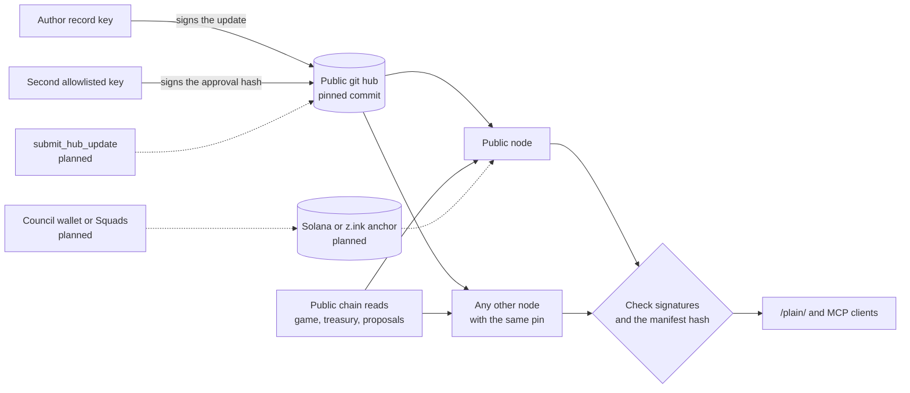
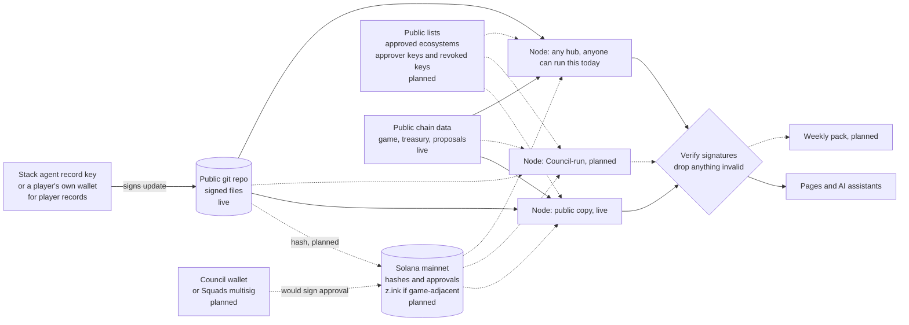

# Is it centralized?

Companion to [spec.md](spec.md). The product name is sa-ecosystem-node. This page says what is live on 1 November 2026, then keeps the later design. The later design is not the running node.

## What is live today

Trust for a hub update is an **ed25519 signature from an allowlisted key, checked by the node**, plus a **git commit pin**. The key can be an agent machine key or a wallet; the node treats them the same. It is not a Solana account.

- The public node is [https://sa-ecosystem-node-dashboard.vercel.app](https://sa-ecosystem-node-dashboard.vercel.app), Vercel project `sa-ecosystem-node-dashboard`. It is separate from the DAO Council preview. Source is [https://github.com/PhoenixClaw01/sa-ecosystem-node](https://github.com/PhoenixClaw01/sa-ecosystem-node) under Apache-2.0.
- `tools/list` returns 22 read-only tools. The server does not sign and does not send transactions.
- Hub files live in [https://github.com/PhoenixClaw01/sa-ecosystem-hub](https://github.com/PhoenixClaw01/sa-ecosystem-hub). The public node pins one commit and the sha256 of the manifest. On 1 November 2026 that commit was `f064f18db1da60c4f3e562d4064c8f344042e97e`. There is **no on-chain anchor**. A hash on Solana or on z.ink is not written and is not checked.
- An update is shown when the author is on the node's allowlist and enough distinct allowlisted keys have signed the approval message. The public node uses that rule: today a record needs 2 distinct allowlisted keys; the author's own approval counts. That approval is a detached ed25519 signature (the same bytes a wallet makes with `signMessage`). It is not a Council wallet policy and it is not a Squads vault transaction. Squads in this version is a read-only decode of the two published treasury multisigs.
- Revocation that is live is a local list of signer public keys (`hub.revokedSigners` / `HUB_REVOKED_SIGNERS`). It takes effect when that node loads config. Revoking a whole signer group is not implemented.
- Anyone can run the same program. Steps are in [hosting.md](hosting.md). A second node shows the same hub rows when it uses the same commit, the same manifest hash, and the same signer rules.
- There is no `submit_hub_update` tool, no moderation queue, and no self-claim button. Publishing is a commit in the hub repository.

If the public site is down, the hub repository and the chain data it reads are still public. Another person can run a node and pin the same commit. That is the live redundancy. It does not depend on an anchor account that has not been built.

Solid arrows are live. Dashed arrows are planned. They are drawn here so a reader can see they are not part of the check the node runs today.

## Target design, not built

The rest of this page is the design for a later version. Council or Squads approvals, on-chain anchors, and a submit tool are not in v1.0.0. Do not read the table below as a description of the public node.

## 1. The objections, answered

Answers in the present tense are true of v1.0.0. Sentences marked planned are the later design.

| Objection | Answer |
|---|---|
| "It's centralized: Phoenix controls it." | The node is open source, and anyone can run it. Phoenix runs one public copy. That copy has no extra key. Live approval is the allowlist in `hub/signers.json`, checked on each node. A Council signature as the only approval is planned, not built. |
| "Single point of failure." | Every node can read the same public chain endpoints and the same public git hub. If one node goes down, another can pin the same commit. A DAO dashboard that switches feed URLs is planned. |
| "Security risk to the treasury." | Nodes hold no funds, no game keys, and no Council keys. The server does not sign. Treasury figures are read from public chain data and a local cache. |
| "Someone could post fake updates." | Today an update is shown only when the author is allowlisted and the approval threshold of distinct allowlisted keys is met. Planned: a per-key rate limit and a visible trust level showing whether one stack or several approved it. A Council approver signature, as a further requirement, is planned. |
| "You could quietly edit or delete history." | Updates are signed files in a public git repo. Editing a file breaks the signature or the manifest hash. Anchoring those hashes on Solana is planned. It is not what the node checks today. |
| "Vendor lock-in." | The licence is Apache-2.0 and the file format is JSON. Anyone can fork the repository. Moving the repository to a Council-owned organization is planned. |

## 2. Trust model the later design aims at: signatures, not servers

Planned. The live check is the one in "What is live today".

1. **The ecosystem signs.** An approved stack writes an update and signs it with its own **agent record key** (most businesses and guilds have no wallet). A player signs their own identity and publishing records (`story-optin`, player claims) with **their own wallet**.
   - Each stack vouches for, rotates, or revokes its own record keys with one PR to a signer-set file. There is no wallet delegation. See [protocol/TRUST-ARCHITECTURE.md](../protocol/TRUST-ARCHITECTURE.md).
   - A second key approves. A countersign from another stack is an optional trust upgrade, shown as a trust level, never a gate.
2. **The Council would approve by signing.** The approval would be a **Council wallet signature**, or a **Squads multisig** approval so no single person decides. v1.0.0 uses the node allowlist instead.
3. **Files stay in the open.** The signed file goes into the public git repo. The later design also anchors its hash and approval on Solana mainnet, or on z.ink for game-related updates. Those anchors are not built.
4. **Nodes would verify.** Before showing anything, every node would check both signatures against:
   - the public list of approved record keys and approver keys;
   - the revocation list;
   - the on-chain anchor.
5. **Readers can check the live files today.** Each returned update includes `signedBy` and `approvedBy`. A reader can verify those detached signatures against the pinned commit. There is no anchor to compare them with yet.

## 3. Where the signed updates live
| Option | Cost | Permanence | Ease | Role |
|---|---|---|---|---|
| **(a) Public git repo of signed update files** | Free | Good. Full history, copied by every clone. Signatures prove authorship even if a host removes it | Easiest. Review by pull request. This is what v1.0.0 uses | **Live.** The public hub is `PhoenixClaw01/sa-ecosystem-hub` |
| **(b) Solana mainnet:** memo or compressed accounts/state for update hashes and approvals | Small fee per anchor. Exact cost not measured. This anchor is not built | As long as Solana runs, once it exists | Moderate. A memo needs no custom program; compressed state needs tooling | **Planned** source of truth for hashes and approvals |
| **(c) z.ink** for game-adjacent hashes | Not measured. Not built | As long as z.ink runs, once it exists | Moderate. Same tooling shape as Solana | **Planned.** Not the game read the node already does |

**Plan:** git now, which is done. Then anchor every update's hash and its approval on Solana mainnet (z.ink for game-related items), with git kept as the readable mirror. A node cannot rebuild approvals from the chain until those anchors exist.

## 4. Anyone can run a node
- **What it takes:** one command (`npx` or Docker) or a one-click Vercel template. The steps and the other hosts are in [hosting.md](hosting.md). It needs a public RPC address and the public store URL. **No secrets, no keys, no paid services required.**
- **How nodes stay consistent today:**
  - They read public chain endpoints and, when pinned, the same signed files at the same commit.
  - They do not read an on-chain anchor. That check is planned.
  - The same commit, the same manifest hash, and the same signer rules give the same hub rows. Treasury history can differ until both caches are refreshed.
  - A hub-relative logo URL from `list_listings` contains the pinned commit. Tools do not all return a separate store-version field.

## 5. What if something goes wrong?
| Scenario | What happens | Fix |
|---|---|---|
| **The public node goes down** | The hub repository is still public. Someone else can run a node and pin the same commit. A dashboard that switches feed URL by itself is planned. | Point clients at another node, or run one. Hub files are in git. They are not stored in a Solana anchor. |
| **A malicious node** shows fake or missing updates | Readers can check `signedBy` and `approvedBy` against the pinned commit. | Use a node whose pin and allowlist you trust. |
| **An allowlisted key is compromised** | That key can sign updates that meet the rules the node already enforces. A delegated agent key is not implemented, so there is nothing of that kind to expire. | Remove the key with `HUB_REVOKED_SIGNERS` on each node, and stop using it in new approvals. A Council revocation list and a Squads approval vault are planned. |
| **One approver is not enough** | The public node asks for two approvals, and the author's own approval can be one of them. | The later design uses a Squads multisig so one key cannot approve alone. That multisig is not the live approval check. |

In every case, **no funds or game assets are at risk**: nodes never hold them.

## 6. Who governs the code
- **Licence, live:** Apache-2.0. The public repository is `PhoenixClaw01/sa-ecosystem-node`.
- **Ownership, planned:** a move to a Council-owned GitHub organization. That move has not happened.
- **Contributions, live:** anyone can open a pull request. GitHub Actions runs lint, typecheck, and tests.
- **Planned, not in the repo today:** a maintainer named by the Council, signed release tags, and a published security policy. This repository has no `SECURITY.md`.

## 7. What stays centralized, and why it's optional
- **The public node, live:** one hosted copy at `sa-ecosystem-node-dashboard`, with `/plain/` and the MCP endpoint. It holds no keys. Anyone can run their own copy. An embed widget, a paid DAO tier, and uptime support as a product are planned.
- **The weekly pack, planned:** a script and chart cards built from public inputs. It is not a tool in v1.0.0.
- **Hosting the public copy** does not put DAO keys on the server.

## 8. Roadmap
1. **Read-only tools, signature checks, and the git store.** Done in v1.0.0. Game reads use the z.ink test realm. Treasury and player reads use public mainnet data.
2. **Two or more independent nodes,** run by different operators, to prove they agree. Planned. One public node is live, and anyone can start another.
3. **Security review** of the signature checks, revocation handling, and node setup, with the findings published. Planned.
4. **Open source.** Done. The repository is public under Apache-2.0. Hosting steps are in [hosting.md](hosting.md).
5. **Transfer to the Council.** Planned. Approver keys would stay in the Council's wallets or multisig. They do not today.

*Ground rules throughout:* read-only first; no ATMTA release form for the open directory and the permissionless layers; no signing bots or game automation without ATMTA's written authorization. The public source repository is [https://github.com/PhoenixClaw01/sa-ecosystem-node](https://github.com/PhoenixClaw01/sa-ecosystem-node).
