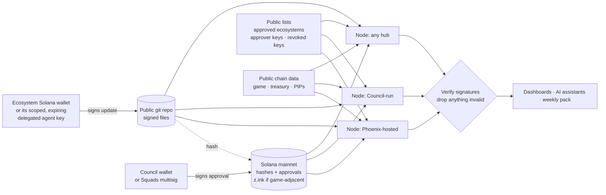

> Draft / target design — Council/Squads approvals, on-chain anchors and a submit tool are NOT built yet. Current behaviour: see README.
>
> Current revocation is a local list of signer public keys (`hub.revokedSigners` / `HUB_REVOKED_SIGNERS`). It takes effect when that node loads config. Revoking a whole signer group is not implemented. The Council revocation list in the diagram below is still the target design.

# Is it centralized? How the DAO Ecosystem Connection avoids a single point of failure
Companion to the DAO Ecosystem Connection spec · Phoenix Collective · for the Star Atlas DAO Council · **Draft**

**Short answer:** trust lives in **signatures, not servers.** Every update carries a **Solana wallet signature** from the ecosystem that wrote it, and a Council wallet (or Squads multisig) approval. Anyone can run a node that checks those signatures against public data. If any one server disappears, including ours, the data and the rules are still there.

## 1. The objections, answered
| Objection | Answer |
|---|---|
| "It's centralized: Phoenix controls it." | The node is open-source, and anyone can run it. Phoenix runs one polished copy, but it has no special powers. Approval comes from Council signatures, not from our server. |
| "Single point of failure." | Every node reads the same public chain data and the same public store of signed updates. If one node goes down, others keep serving. The DAO dashboard can point at any node. |
| "Security risk to the treasury." | Nodes hold **no funds, no game keys and no Council keys.** Write access only adds update text and links. Treasury data is read straight from the chain. |
| "Someone could post fake updates." | An update counts only if it carries a valid signature from an approved ecosystem wallet **and** a Council approver signature. Nodes reject anything else. |
| "You could quietly edit or delete history." | Updates are wallet-signed files in a public git repo, with their hashes and approvals anchored on Solana mainnet. Any edit breaks the signature, and the history is public. |
| "Vendor lock-in." | Open licence, Council-owned repo after the proving period, and plain file formats. Anyone can fork it. |

## 2. Trust model: signatures, not servers
1. **The ecosystem signs.** An approved ecosystem writes an update and signs it with its own **Solana wallet**.
   - An agent can sign for a hub **only with a scoped, expiring key that the hub's wallet delegated to it**.
   - The hub can revoke that key at any time.
2. **The Council approves by signing.** The approval is a **Council wallet signature**, or a **Squads multisig** approval so no single person decides.
3. **It's stored in the open.** The signed file goes into the public git repo. Its hash and approval are anchored on Solana mainnet, or on z.ink for game-related updates.
4. **Nodes verify.** Before showing anything, every node checks both Solana signatures against:
   - the public list of approved ecosystem wallets, delegated keys and approver keys;
   - the revocation list;
   - the on-chain anchor.
5. **Readers can check too.** Each update shows who signed it, so a reader or an AI assistant can verify it independently.

## 3. Where the signed updates live
| Option | Cost | Permanence | Ease | Role |
|---|---|---|---|---|
| **(a) Public git repo of wallet-signed update files** | Free | Good. Full history, copied by every clone. Signatures prove authorship even if a host removes it | Easiest. Review by pull request, works today | **v0.** Later the full-text mirror and index |
| **(b) Solana mainnet:** memo or compressed accounts/state for update hashes and approvals | Small fee per anchor. **Exact cost to be measured** in the testnet phase | As long as Solana runs. Tamper-evident | Moderate. A memo needs no custom program; compressed state needs tooling | The **source of truth** for hashes and approvals |
| **(c) z.ink** (Star Atlas's SVM chain) | **To be measured** | As long as z.ink runs | Moderate. Same tooling as Solana | Hashes and approvals for **game-adjacent** updates |

**Plan:** git now. Then anchor every update's hash and its approval on Solana mainnet (z.ink for game-related items), with git kept as the readable mirror and index. A node can rebuild everything from git plus the chain.

## 4. Anyone can run a node
- **What it takes:** one command (`npx` or Docker) or a one-click Vercel template. The steps and the other hosts are in [hosting.md](hosting.md). It needs a public RPC address and the public store URL. **No secrets, no keys, no paid services required.**
- **How nodes stay consistent:**
  - They all read the same chain data, the same on-chain anchors and the same signed files.
  - Results are deterministic: the same inputs and the same lists give the same output.
  - Each node shows the store version it's serving, so differences are easy to spot.

## 5. What if something goes wrong?
| Scenario | What happens | Fix |
|---|---|---|
| **The Phoenix node goes down** | Other nodes keep serving. The dashboard switches its feed URL. | Nothing is lost; the data lives in the public git repo and on Solana. |
| **A malicious node** shows fake or missing updates | Readers and other nodes can check signatures and spot it. | Point the dashboard at a trusted node. Anyone can publish a comparison. |
| **A hub's wallet or delegated agent key is compromised** | The attacker can sign updates, but none get published without a Council approval. Delegated keys also expire on their own. | The hub revokes the delegated key or rotates its wallet. The Council adds the old key to the revocation list, and nodes ignore it from then on. |
| **An approver key is compromised** | Risk of bad approvals. | Use a **Squads multisig** for approvals (e.g. 2 of 3), so one key can't approve alone. Revoke the key through the multisig, and nodes re-check history against the revocation list. |

In every case, **no funds or game assets are at risk**: nodes never hold them.

## 6. Who governs the code
- **Licence:** open source under **Apache-2.0**.
- **Ownership:** Phoenix builds and proves it, then the repo **moves to a Council-owned GitHub organization.**
- **Contributions:**
  - Anyone can open a pull request.
  - Every change needs automated tests to pass, plus review by a maintainer the Council names. The selected dashboard developer reviews anything touching the dashboard.
  - Releases are tagged and signed.
  - Security issues are reported privately through a published security policy.

## 7. What stays centralized, and why it's optional
- **The Phoenix-hosted node:** a polished copy with the embed widget, feed, uptime monitoring and support. It's a convenience the DAO tier pays for, not a gatekeeper. Anyone can run their own.
- **The weekly pack generator:** it turns approved updates and highlights into a script and chart cards. Its inputs are all public, so anyone can rebuild or replace it, and the presenter always edits before anything goes out.
- **Phoenix hosting** moves to a Phoenix organization account. It holds no keys that matter to the DAO.

## 8. Roadmap
1. **Private build:** read-only tools, signature checks, the git store.
2. **Testnet with 2+ independent nodes:** run by different operators, ideally including one the Council runs, to prove they agree.
3. **Security review:** an independent review of the signature checks, revocation handling and node setup. Findings are published.
4. **Open source:** a public repo under Apache-2.0, with a node template and a contributor guide.
5. **Transfer to the Council:** the repo moves to the Council's GitHub, and approver keys stay in the Council's wallets or multisig.

*Ground rules throughout:* read-only first; no ATMTA release form for the open directory and the permissionless layers; no signing bots or game automation without ATMTA's written authorization. Contact: support@phoenix-collective.app
