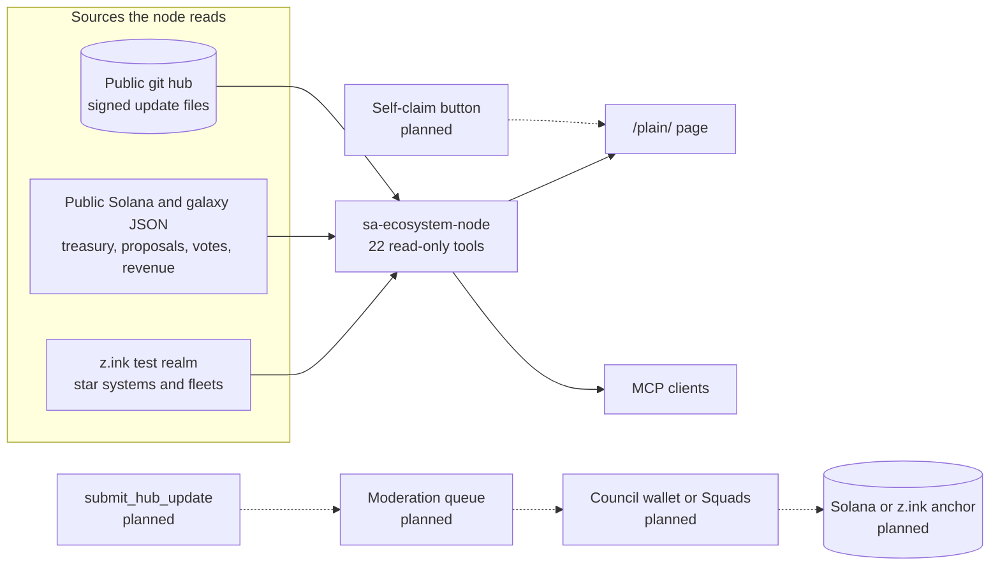
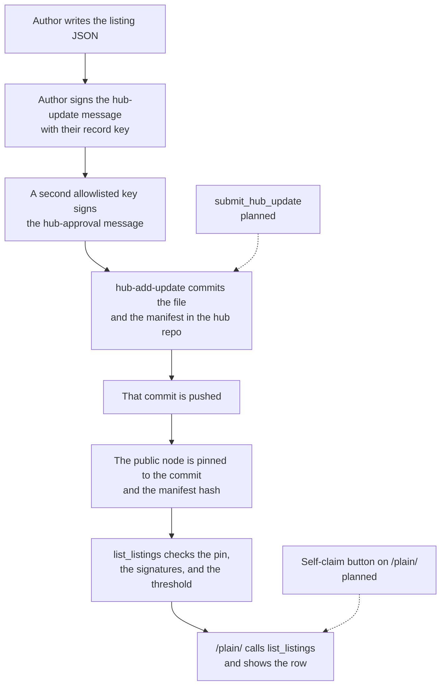

# Star Atlas Ecosystem Node: spec v1.0.0

1 November 2026. This page describes the node that is running, then lists what is only planned.

The product name is **sa-ecosystem-node**. It is not an ATMTA product, and "Star Atlas" is not the product name. The server says so on every read: "Inspired by Star Atlas. Unofficial community read. This node is not affiliated with ATMTA, holds no funds, and holds no game or Council keys."

Version `1.0.0` is `SERVER_VERSION` in `src/version.ts`. The public copy is [https://sa-ecosystem-node-dashboard.vercel.app](https://sa-ecosystem-node-dashboard.vercel.app). Source is [https://github.com/PhoenixClaw01/sa-ecosystem-node](https://github.com/PhoenixClaw01/sa-ecosystem-node) under [Apache-2.0](../LICENSE). Hub text (listings, guild records, descriptions, and lore) is CC BY 4.0, as the hub repository states. Each project keeps the rights to its own name and logo.

## What it is today

One public, read-only program. People open a web page. AI assistants call the same program through MCP, a standard way for those assistants to ask for data.

It does three jobs:

1. **Read public game and DAO data.** Star systems and fleets come from the z.ink test realm. Treasury balances, proposals, votes, and revenue come from public Solana mainnet and public galaxy JSON. A player lookup reads public mainnet accounts.
2. **Read a signed hub.** Updates live in a public git repository. Each update is signed by an allowlisted ed25519 key (an agent machine key or a wallet; a player's own wallet for that player's records). The public node shows an update only when the signature checks pass and enough distinct allowlisted keys have approved it.
3. **Show that hub on a page.** A request for `/` on [https://sa-ecosystem-node-dashboard.vercel.app](https://sa-ecosystem-node-dashboard.vercel.app) redirects to `/plain/`. `/plain/` shows listings, groups, hub updates, search results, and a player lookup as a card grid: one column on phones, two columns from 48rem, three from 68.75rem, and four on very wide screens from 93.75rem (`dashboard/plain/plain.css`). Cards in the grid start collapsed (`
` with no `open` attribute). Listings, groups, hub updates, and search each have Expand all, Collapse all, category filter chips, and a sort of A-Z, Newest, or Category (`dashboard/plain/plain.js`). The sort starts at A-Z. Groups are the guild rows from `hub_updates`. The page calls same-origin `/api/mcp` for `list_listings`, `hub_updates`, `search_hub`, `player_legacy`, and `player_story`. Under Listings there is one signed note, "What does signed mean?": "Signed means approved hub signers checked and published this record with their wallets. It is not an endorsement, it is not proof of ownership, and it does not move money. The business is responsible for its own offer." The one payment line is: "This page does not take payment. Offers link to each business's own page." Each card can show the word Signed. `signedMeaning` is a field on `list_listings` results. The page does not print that field on each card.

The server does not sign, does not send transactions, and does not hold keys or funds. There is no submit button and no moderation queue in this version.

Solid lines are live. Dashed lines are planned and are not in this version. The planned list is at the end of this page.

## The public site

| What | Where |
|---|---|
| Vercel project | `sa-ecosystem-node-dashboard`. This project is separate from the DAO Council preview |
| Site | [https://sa-ecosystem-node-dashboard.vercel.app](https://sa-ecosystem-node-dashboard.vercel.app) |
| Home | `PUBLIC_HOME=plain` makes `/` and `/index.html` answer 302 to `/plain/` (`dashboard/middleware.js`) |
| Reading page | `/plain/` is indexable. It has no `noindex` tag and no `X-Robots-Tag` |
| MCP | [https://sa-ecosystem-node-dashboard.vercel.app/api/mcp](https://sa-ecosystem-node-dashboard.vercel.app/api/mcp) |
| Discovery | [https://sa-ecosystem-node-dashboard.vercel.app/.well-known/mcp.json](https://sa-ecosystem-node-dashboard.vercel.app/.well-known/mcp.json) |

`/plain/` shows listings, groups, hub updates, search results, and a player lookup as a card grid: one column on phones, two columns from 48rem, three from 68.75rem, and four on very wide screens from 93.75rem (`dashboard/plain/plain.css`). Cards in the grid start collapsed (`
` with no `open` attribute). Listings, groups, hub updates, and search each have Expand all, Collapse all, category filter chips, and a sort of A-Z, Newest, or Category (`dashboard/plain/plain.js`). The sort starts at A-Z. Groups are the guild rows from `hub_updates`. The page calls same-origin `/api/mcp` for `list_listings`, `hub_updates`, `search_hub`, `player_legacy`, and `player_story`. Under Listings there is one signed note, "What does signed mean?": "Signed means approved hub signers checked and published this record with their wallets. It is not an endorsement, it is not proof of ownership, and it does not move money. The business is responsible for its own offer." The one payment line is: "This page does not take payment. Offers link to each business's own page." Each card can show the word Signed. `signedMeaning` is a field on `list_listings` results. The page does not print that field on each card. No API key.

Checked on 1 November 2026: `initialize` returned server `sa-ecosystem-node` version `1.0.0`, and `tools/list` returned the 22 tools below. Every one has `readOnlyHint: true`.

## Tools

The names are the tools registered in `createNodeServer` (`src/server.ts`) and `registerDaoTools` (`src/dao/register.ts`). The same names are the `READ_ONLY_TOOLS` list. `submit_hub_update`, `fleet_status`, `moderation_queue`, and `weekly_pack` are not registered.

| Tool | What a person gets |
|---|---|
| `list_star_systems` | Star systems on the z.ink test realm, through `@aephia/atlas-kit` |
| `get_fleet` | One fleet by address, or the fleets owned by a profile, on that same realm |
| `profile_key_audit` | Keys on a profile: scope, expiry, permissions, and heuristic risk flags. The node does not use those keys |
| `player_legacy` | Public mainnet record for one wallet or profile: profiles, creation, faction, SAGE fleets still on the accounts, and first and last activity |
| `player_story` | A short story from that record, only after the wallet opts in. Otherwise the tool says not opted in and does not tell the story |
| `dao_overview` | Treasury balances, a short proposal list, and data-health checks. A failed section is an error, not a made-up figure |
| `galaxy_overview` | Star systems, starbases, and an activity summary from the z.ink read |
| `list_categories` | Five category ids. Members are `unknown` until a public roster exists |
| `search_hub` | One text query over signed listings, guild listings, and display names of players who opted in |
| `list_proposals` | One page of the public galaxy proposal list |
| `get_proposal_votes` | Vote counts and voting power for one proposal. No ranked-choice winner is invented |
| `dao_revenue` | Monthly revenue from galaxy `/dao/treasury` |
| `dao_treasury_flows` | Monthly inflows and outflows from the local treasury cache |
| `dao_payments` | Payment rows from that cache |
| `treasury_history` | Balance over time from that cache |
| `ecofund_limit` | The PIP-23 Ecosystem Fund limit, from the cache plus the PIP text |
| `treasury_balances` | Live SOL, ATLAS, and USDC for the two published wallets, plus a Squads v3 decode when the live read works |
| `pip_tracker` | Payments and milestones from the public Council Tracker sheet. Blank cells stay null |
| `hub_updates` | Signed hub updates from the pinned git commit. Claim records and attestation records are left out |
| `list_listings` | Signed business listings from that commit. The node does not take payment |
| `claim_status` | Whether a listing or guild name has a claim, and what state that claim is in |
| `data_health` | Freshness and the last error for the cache, galaxy, the Council sheet, and wallet balances |

### Tool inputs

Omitted optional fields use the defaults in the table. Unknown extra fields are rejected by the schema.

| Tool | Fields |
|---|---|
| `list_star_systems` | `limit` optional integer, 1 to 500. Default 100 |
| `get_fleet` | `fleetAddress` or `profileAddress`. At least one is required |
| `profile_key_audit` | `profileAddress` |
| `player_legacy` | `address`, 32 to 44 characters |
| `player_story` | `address`, 32 to 44 characters |
| `dao_overview` | none |
| `galaxy_overview` | `limit` optional integer, 1 to 500. Default 100 |
| `list_categories` | none |
| `search_hub` | `query`, at most 80 characters |
| `list_proposals` | `pipNumber` optional, `status` optional, `limit` optional 1 to 100 (default 20), `cursor` optional |
| `get_proposal_votes` | `proposalId` or `pipNumber`, `topN` optional 0 to 20 (default 0) |
| `dao_revenue` | `from` and `to` as `YYYY-MM`, optional `segmentation` |
| `dao_treasury_flows` | optional `wallet`, `mint` (`ATLAS`, `USDC`, or `SOL`), `from`, `to`, `allowPartial` |
| `dao_payments` | those filters, plus `direction` (`in`, `out`, or `all`), `includeInternal`, `includeFees`, `limit` 1 to 500, `offset` |
| `treasury_history` | `wallet`, `mint`, `from` and `to` as `YYYY-MM-DD`, `granularity` (`day` or `month`), `allowPartial` |
| `ecofund_limit` | optional `asOf`, `unpaidPips`, `councilOverride` |
| `treasury_balances` | none |
| `pip_tracker` | none |
| `hub_updates` | optional `kind`: `announcement`, `proposal-note`, `payment-note`, `status`, `signer-change`, `listing`, `guild`, `story-optin`, `claim`, or `attestation`. A `claim` or `attestation` filter still returns no rows, because those kinds are removed before the response |
| `list_listings` | optional `stream` (`referral`, `hybrid`, `irl`, `player`), `category`, `status`, `includeExpired` |
| `claim_status` | optional `identity`: a listing id, a guild name, `id:<listingId>`, or `guild:<normalized name>`. Omit it to list every claim |
| `data_health` | none |

`wallet` on the treasury tools is `dao_treasury`, `ecosystem_fund`, or one of the two published addresses.

`list_categories` returns these ids, each with `members: "unknown"` (`src/stubs/hub-update.ts`, `src/dao/hub.ts`):

`ip_and_business`, `creators`, `developers_and_tools`, `guilds_and_dacs`, `events`.

## How a listing gets onto /plain/

A listing is a file in the hub repository. The public page does not accept the file. A signer writes it, a second signer approves it, and the node reads the pinned commit.

On the public node the threshold is 2 and the author's own approval counts as one of the two (`HUB_APPROVAL_THRESHOLD=2`, `HUB_ALLOW_AUTHOR_APPROVAL=true`). The author key shipped in `hub/signers.json` is Phoenix Collective (`G2PhCi6MApcuC6f5o2CDQBWDnJt9hRcozHuuN55PYisU`). Falkor (`FC1eRr99GGJZuc4KZeUivBpbSMGvjcBB839KaEfAuhcq`) supplies the second signature. GaliaMeta DAC (`EU7zwmY8QP7B9FFUUyMu1eTNkrwuj27NQkgEmNMWreq1`) is on the same allowlist and is not required for that pair. The same wallet twice counts once.

The node does not upload images. A curator commits a png, jpeg, or webp into the hub. `/plain/` loads only that hub-relative path, resolved to `raw.githubusercontent.com` at the pinned commit.

## The hub pin

Set all three, or set none. If any one is missing, hub tools read nothing and invent nothing.

| Name | Meaning | Public node, 1 November 2026 |
|---|---|---|
| `HUB_GIT_REPO` | `https` URL of a public git repository, with no username, password, query, or hash | `https://github.com/PhoenixClaw01/sa-ecosystem-hub` |
| `HUB_GIT_COMMIT` | Full 40-character commit | `f064f18db1da60c4f3e562d4064c8f344042e97e` |
| `HUB_STORE_MANIFEST_HASH` | sha256 hex of the manifest file the node reads | `1fd4536e3a5b4176beebc04c16c53834092f519d98c0e30172862a2f24ae24f2`, the sha256 of `hub-manifest.json` at that commit |

The commit above is the one a live hub-relative logo URL used that day. `list_listings` returned rows. It refuses the whole read when the manifest hash does not match the file it opened. The hub id stored in claims and story opt-ins is the normalized repository URL `https://github.com/phoenixclaw01/sa-ecosystem-hub` (lowercase, no trailing `.git`).

`HUB_STORE_MANIFEST`, when unset, selects `hub-manifest.json`. If that file is missing, the node tries `manifest.json`. Setting the variable selects one path and does not try the other name. The manifest is `{ "v": 1, "updates": ["updates/one.json"] }`.

A host with `git` checks out the commit. The Vercel function has no `git` binary. It downloads a public `github.com` repository at that commit over HTTPS (`src/hub/github-archive.ts`). Another git host still needs `git`.

## Signed update record

Schema `sa-ecosystem-node.hub-update.v1`. One file is `{ "payload", "signature", "approvals" }`.

Payload fields: `v` (1), `id`, `created_at` (UTC with milliseconds), `author` (base58 address), `kind`, `body`, `refs` (`pip` and `txs`), `prev`. `prev` is null on the first update. After that it is the sha256 hex of the previous payload's canonical JSON.

`kind` is `announcement`, `proposal-note`, `payment-note`, `status`, `signer-change`, `listing`, `guild`, `story-optin`, `claim`, or `attestation`.

Canonical JSON sorts keys and has no whitespace. The author signs the UTF-8 bytes of `sa-ecosystem-node:hub-update:v1\n` plus that JSON. Each approver signs the UTF-8 bytes of `sa-ecosystem-node:hub-approval:v1\n` plus the sha256 hex of that JSON. Signatures are detached ed25519, stored as base58. An approval is the bytes a Solana wallet signs with `signMessage`. It is not a transaction and it moves no funds.

An allowlisted update is returned only when the author signature matches a trusted signer set, enough distinct approvals from that set are present, and the update links the hash chain. The author signature is not itself an approval. At threshold 1 the author's own approval counts, and the row has `selfApproved: true` when that key is the only approver. At threshold 2 or higher the author's approval counts only when `HUB_ALLOW_AUTHOR_APPROVAL` is true. A `signer-change` never counts the author.

`signedBy` lists the author and every key whose signature verified. `approvedBy` lists only the keys whose approvals counted.

`HUB_REVOKED_SIGNERS` is a local list of public keys. It takes effect when the process loads config. An approval from a revoked key does not count. An update whose only valid approvals are from revoked keys is `revoked_signer`. Revoking a whole signer group is not implemented.

`hub_updates` leaves out kind `claim` and kind `attestation` (`selectPublicUpdates` in `src/dao/hub.ts`). A listing or guild signed by a claimant is included only when that claim is active.

### Listing fields

Kind `listing`, object `listing`. Required: `stream`, `category`, `title` (at most 160 characters), `owner` (at most 120), `url` (the business's own https page), `status`, `asOf`, `expiresAt`. `expiresAt` falls on `asOf` or at most 90 days later. Both dates are `YYYY-MM-DD`. A listing is still shown on its expiry date. A date before the current UTC date is hidden unless `includeExpired` is true, and those rows have `expired: true`.

`stream`: `referral`, `hybrid`, `irl`, `player`. `category` is one `list_categories` id. `status`: `available`, `sold_out`, `inquire_only`, `paused`, `withdrawn`. `withdrawn` is a takedown and is left out of `list_listings`. `disclosure` is required when `stream` is `referral`. Optional: `offerText`, `verifyLiveNote`, `ownershipProof` (`method` of `wallet_signed`, `site_code`, or `signer_review`, plus `evidenceRef`), `image`, `listingId`. Longer text fields are at most 500 characters. Unknown fields are rejected.

`image` is `{ url, alt, link? }`. `alt` is required (at most 140 characters). `url` is https and the path ends in `.png`, `.jpg`, `.jpeg`, or `.webp`, or it is a hub-relative path with that extension. SVG, `data:`, `javascript:`, and `http:` are refused. `list_listings` sets `image.src` only for a hub-relative path. `src` is not part of the signature.

The newest hub-chain update for an identity wins. Chain order follows `prev`, not `created_at`. Set `listingId` on every new listing. Without it, the identity is stream, category, and the normalized title and owner.

`signedMeaning` for an allowlisted author is: `Signed by <display name>. This signature means that signer published this listing. It does not move money, and this node never handles payment.` A claimant row uses: `Signed by the claimant for this listing. This signature does not move money, and this node never handles payment.` That field is in `list_listings` results. `/plain/` does not print it on each card.

### Guild fields

Kind `guild`, object `guild`. This is not a listing stream. Fields: `name` (at most 80), `description` (at most 280), `links` (up to 8 https URLs), optional `tags` (1 to 8 labels), optional `image`, optional `site`, optional `discord`, optional `withdrawn: true`. `discord` is only `https://discord.gg/<code>` or `https://discord.com/invite/<code>`, at most 80 characters. A guild that is not withdrawn needs `site` or at least one link. There is no member list and no wallet field. A price word or a wallet-shaped token in the name, description, tags, or image alt is rejected. A wallet-shaped token in a URL is rejected. A price word in a URL is not.

### Story opt-in

Kind `story-optin`, object `storyOptIn`: `action` (`allow` or `revoke`), `wallet`, `date` (`YYYY-MM-DD`), `signature` (the player's detached signature, base58). A story opt-in is signed only by the player's own wallet. An agent may prepare the message and the evidence, but never signs it for the player.

Allow sentence, links yes or no:

`I allow sa-ecosystem-node to tell my public Star Atlas story. Wallet: <address>. Date: <YYYY-MM-DD>. Hub: <id>. Links: yes.`

`I allow sa-ecosystem-node to tell my public Star Atlas story. Wallet: <address>. Date: <YYYY-MM-DD>. Hub: <id>. Links: no.`

Revoke sentence:

`I revoke sa-ecosystem-node from telling my public Star Atlas story. Wallet: <address>. Date: <YYYY-MM-DD>. Hub: <id>.`

`<id>` is the normalized `HUB_GIT_REPO` URL, such as `https://github.com/owner/repo`. It is not the manifest file name. An allow counts only when its date is strictly after the latest revoke date. A future date stays in the chain and does not count until that UTC date. Without a valid unrevoked opt-in, `player_story` returns not opted in. If the hub URL is missing or not a valid https repository, the tool returns not available. Story sentences do not copy names or prices. Listings stay in a separate `listings` field. The steps for a claim are in [claim-and-verify.md](claim-and-verify.md).

### Claim and attestation

Kind `claim` binds one public key (for a player, their own wallet) to one listing id or one guild name. Kind `attestation` is a verifier's statement about Discord or X. Neither kind is returned by `hub_updates`. `claim_status` returns the claim state. The field list, the states, and the commands are in [claim-and-verify.md](claim-and-verify.md).

## Wallets the treasury tools read

| Role | Address |
|---|---|
| DAO Treasury | `CuwnarNh7FEqZMmffFjRyWj54RecyS7zwFg1CxfzNudi` |
| Ecosystem Fund | `BxKehkp298nQunu8BWxh5U6VvfphFyjEB3t7USst7Uag` |

`treasury_balances` reads those wallets live. History, payments, flows, and `ecofund_limit` read `data/treasury-cache.json` (on the public site, `dashboard/data/treasury-cache.json`). They do not refresh it. A missing cache is an error, not an empty ledger of zeros. `npm run refresh-treasury` is the writer, and it sends only read RPC methods.

`ecofund_limit` follows the text of [PIP-23](https://govern.staratlas.com/proposals/0ecf2928-15df-497e-8b67-d87eda030d5a). Where that text states no rule, the tool returns `unknown`.

## Limits on the public MCP

Each request has a 20 second timeout (`REQUEST_TIMEOUT_MS` in `src/public-mcp.ts`). The Vercel function `maxDuration` is 25 seconds (`dashboard/vercel.json`). The request body and the response are each capped at 512 KiB. A larger request is HTTP 413 before a tool runs. A larger response is replaced, not truncated. The server allows 120 requests per minute per client key on each instance. On Vercel, `TRUST_PROXY=1`, so the key is the first `X-Forwarded-For` hop. The limiter is in memory. It is not shared across instances, and a restart clears it.

## Run it yourself

[hosting.md](hosting.md) covers a laptop, Docker, stdio for Claude Desktop and Cursor, and other hosts. A local `npm start` serves MCP at `http://127.0.0.1:8787/mcp`. `GET /` on that process is a status document. It does not redirect to `/plain/`, because `PUBLIC_HOME` is read only by the dashboard middleware.

Anyone can run a node. Nodes do not share a database. Two nodes agree on hub rows when they pin the same commit, the same manifest hash, and the same signer rules. They can differ on treasury history until both have refreshed the cache.

## Planned, not built

Nothing in this section is an MCP tool, a route, or a button in v1.0.0. The types live in `src/stubs/hub-update.ts` and `src/stubs/approval.ts`. `APPROVAL_VERIFICATION_STATUS` and `HUB_UPDATE_IMPLEMENTATION` are `not_implemented`. `submit_hub_update` is a TypeScript type only. `createNodeServer` does not register it.

| Planned | What v1.0.0 does instead |
|---|---|
| `submit_hub_update` | No submit route. `POST /submit` on the Node server is 404. Publishing is a git commit in the hub repo |
| Moderation queue | No queue. An update is public when it is in the pinned commit and the signature checks pass |
| Council wallet or Squads signature as the approval | Approval is a detached signature from the node's allowlist (`hub/signers.json`), at the configured threshold. Squads in this version is a read-only decode of the two published treasury multisigs |
| On-chain anchors for update hashes, on Solana mainnet or z.ink | The pin is the git commit plus the manifest sha256. There is no memo and no anchor account |
| Self-claim button on `/plain/` | A person signs a claim with the `hub-claim` command. A hub editor commits that file. The page has no claim form |
| Weekly pack, embed widget, and a DAO-tier feed for an ATMTA-hosted dashboard | Not built. `/plain/` is the public page |
| Application form and a roster of approved ecosystems per category | `list_categories` returns ids and `members: "unknown"` |
| Agent record keys vouched per stack (one PR to a signer-set file), a shown trust level (`single-stack` / `multi-stack`), per-key rate limits, kind-scoped signer sets | Not implemented. Drafted in [protocol/TRUST-ARCHITECTURE.md](../protocol/TRUST-ARCHITECTURE.md) and [protocol/h2h/SPEC.md](../protocol/h2h/SPEC.md) Appendix A (code items C1–C7). No wallet delegation is planned. The author signs with the key that matches `author` |
| Revoking a whole signer group in one step | `HUB_REVOKED_SIGNERS` drops individual public keys when the process loads config |
| Cloudflare Workers entry | Not included. The hub reader and the HTTP server use Node APIs. See [hosting.md](hosting.md) |
| Moving this repository to a Council-owned GitHub organization | The public source repository is `PhoenixClaw01/sa-ecosystem-node` |

A later design for signatures, anchors, and more than one operator is written in [decentralization.md](decentralization.md). That page starts with what is live so the later design is not read as the current node.
