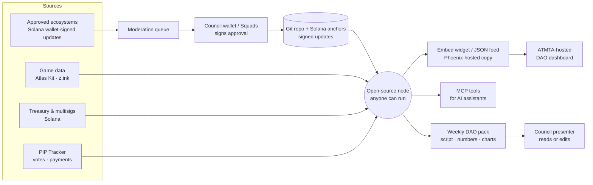

> Draft / target design — Council/Squads approvals, on-chain anchors and a submit tool are NOT built yet. Current behaviour: see README.

# DAO Ecosystem Connection: one-page spec (draft)
Phoenix Collective · for the Star Atlas DAO Council · Oct 28, 2026 brew · **Draft, read-only first**

## 1. The idea
**One connection, data flowing both ways.**
- **Read (anyone):** live game data (via the community Atlas Kit SDK), DAO treasury and multisig balances, PIP votes and payments.
- **Write (approved ecosystems only):** news and updates from the projects building around Star Atlas.
- Built for people (dashboard, weekly pack) and AI assistants (MCP, the standard way AI tools connect to data).

## 2. Ecosystem onboarding
1. **Apply.** Any ecosystem can apply. GBA and Superphoenix are examples of possible lanes, not commitments.
2. **Approved per category:**
   - IP and business
   - Creators
   - Developers and tools
   - Guilds and DACs
   - Events
   - More as the Council adds them
3. **Share what you want.** Each ecosystem decides how much to publish: one headline a month or a full feed.
4. **Attributed.** Every update carries the ecosystem's **Solana wallet signature**. An agent can sign only with a scoped, expiring key delegated by that wallet. Readers can see who said what.
5. **Moderated, then published.** Updates land in a queue. Approval is a Council wallet or Squads multisig signature, and nothing goes public without it.
6. **Safe by design.** Write access only adds update text, links and images. It **never touches funds, wallets, game keys or votes.**

## 3. Delivery
- **(a) Dashboard feed.** The ATMTA-hosted DAO dashboard pulls an **embed widget or a JSON feed per category**.
  - ATMTA keeps full control of its site.
  - The dashboard developer (whoever the Council picks) just reads the feed. No extra backend is needed on their side.
- **(b) Weekly DAO pack.** It's built automatically each week from approved updates, plus treasury and game highlights. It contains:
  - a short script
  - key numbers (treasury, payments, votes, galaxy activity)
  - ready-made chart cards

  The Council's presenter reads it as is, or edits it first. Nothing is published without them.

## 4. Tiers
| | Public (free) | DAO tier |
|---|---|---|
| Who | Anyone, any AI assistant | DAO Council and its dashboard |
| Access | Read-only: game, treasury, PIPs, published updates | Everything public, plus the moderation queue, the weekly pack, category admin and usage reports |
| Cost | Free | Funded through a DAO contract (PIP), milestone-paid |

## 5. Rough tool list (MCP)
| Tool | Type | What it returns |
|---|---|---|
| `galaxy_overview` | read | Star systems, starbases, activity summary (Atlas Kit) |
| `fleet_status` | read | Status of a public fleet or profile |
| `profile_key_audit` | read | Which keys can act on a profile, and any risky ones |
| `treasury_balances` | read | Treasury and Ecosystem Fund balances, multisig signers |
| `pip_tracker` | read | PIP results, payments made and still owed |
| `list_categories` | read | Ecosystem categories and approved members |
| `hub_updates` | read | Published updates, by category or ecosystem |
| `list_listings` | read | Signed business listings. Filter by stream, category, or status. Expired rows stay hidden unless requested, and those rows are marked expired. Includes the signer display name, a plain line for what the signature means, and an optional public logo. The node does not take payment |
| `search_hub` | read | Text search over listing names, descriptions, and tags, guild names, descriptions, and tags, and display names of players who opted in. Opted-out players are left out |
| `claim_status` | read | Claim state for one listing identity or every claim. Players need a player-profile key. Guilds and businesses need a curator countersign. X and Discord stay self-attested unless a trusted verifier attestation is current |
| `player_legacy` | read | Public mainnet profile, faction, fleet, and activity card for one address |
| `player_story` | read | Opt-in plain-language story from that card. Without a valid unrevoked `story-optin`, the tool returns not opted in and does not tell the story |
| `submit_hub_update` | write (approved key) | Sends one update to the moderation queue |
| `moderation_queue` | DAO tier | Pending updates to approve or reject |
| `weekly_pack` | DAO tier | This week's script, numbers and chart cards |

`player_story` reads hub updates of kind `story-optin`. The player signs a fixed allow or revoke sentence. `Hub:` is the normalized `HUB_GIT_REPO` URL, and an allow also has `Links: yes` or `Links: no`. An allow counts only when its date is strictly after the latest revoke date. The latest-dated allow wins. A future date stays in the chain and does not count until that date. Signer, threshold, revocation, and manifest-pin checks match the other hub update kinds. The story cites chain sources, leaves names and prices out of the sentences, and keeps listings in a separate block. Without an https hub repository the tool returns not available.

`list_listings` reads hub updates of kind `listing`. Each listing has a stream (`referral`, `hybrid`, `irl`, or `player`), a category id from `list_categories`, a title, an owner display name, the business's own page or checkout URL, a status (`available`, `sold_out`, `inquire_only`, `paused`, or `withdrawn`), an as-of date, and an expiry at most 90 days later. A referral requires `disclosure`. Optional fields are offer text, a verify-live note, an ownership proof (`wallet_signed`, `site_code`, or `signer_review`, plus an evidence ref), and an `image` (`url`, `alt`, optional `link`). `url` is https png, jpeg, or webp, or a hub-relative path with that extension. SVG, `data:`, `javascript:`, and `http:` are refused. The image is inside the signed payload. Signer, threshold, revocation, and manifest-pin checks match the other hub update kinds. The URL is not a payment endpoint. This node does not take payment and does not upload images. A `withdrawn` listing is left out of `list_listings` and search. Curators commit logo files into the hub repo. The plain page shows only those hub-relative files.

`guild` is its own hub update kind. Listings have no type enum named ecosystem, business, or hybrid. A guild listing has `name`, a short `description`, `links` (https only), optional `tags`, an optional `image`, an optional `site` (https), and an optional `discord` invite (`https://discord.gg/<code>` or `https://discord.com/invite/<code>` only, at most 80 characters). It has no member list and no wallet field. A curator signs it the same way as any other hub update. Search shows the newest guild update for each name. This node does not keep a private takedown list.

`search_hub` reads that same pinned store. One text query matches listing names, owners, categories, streams, and short text, plus guild names, descriptions, and tags, plus display names of players with a current story opt-in. A query longer than 80 characters is refused. When no hub is pinned, the result is empty and says so.

## 6. Rollout (read-only first)
1. **Phase 1, read-only (weeks 1–3):** public read tools plus the dashboard JSON feed for treasury, PIPs and game data. No accounts, no writes.
2. **Phase 2, onboarding (weeks 3–6):** application form, per-category approval, signed/keyed `submit_hub_update`, moderation queue. A pilot with 2–3 volunteer ecosystems.
3. **Phase 3, weekly pack (weeks 6–8):** auto-built pack, presenter review flow, embed widget for the ATMTA dashboard.
4. **Phase 4, DAO tier (after a PIP):** milestone-funded, with usage reports to the Council.

**Ground rules:**
- **Terms of service:** the open directory and the permissionless layers do not need an ATMTA release form. The node stays read-only, uses an "inspired by Star Atlas" disclaimer, and keeps "Star Atlas" out of the product name.
- **No bots:** no signing bots or game automation without ATMTA's express written authorization.
- **No custody:** we never hold Council keys or funds.
- **Review:** the selected dashboard developer reviews anything that touches the Council's dashboard, and ATMTA reviews anything hosted by ATMTA.

## 7. Open and decentralized
- **Its own open-source node.** The Star Atlas ecosystem node is a separate open-source MCP in a public repo on the GaliaMeta side. It's kept apart from Phoenix's private systems.
- **Anyone can run a node:** hubs, the Council, ATMTA. Every node reads the same public chain data, so there's no single point of failure.
- **Neutral storage.** Each update is signed by the ecosystem's Solana wallet, or by a scoped, expiring agent key that wallet delegated. Files live in a public git repo (v0, later the mirror and index). Update hashes and approvals are anchored on Solana mainnet, or on z.ink for game-adjacent updates.
- **Moderation is a signature.** Each approval is a Council wallet or Squads multisig signature, and nodes display only approved updates.
- **The Phoenix node is one polished copy.** The Phoenix-hosted node adds the widget, the feed, the weekly packs and support. That's what the DAO tier pays for. Its hosting moves to a Phoenix organization account.
- **Security:** nodes hold no funds and no game keys. Approver keys stay in the Council's own wallets.

*Contact: support@phoenix-collective.app*
