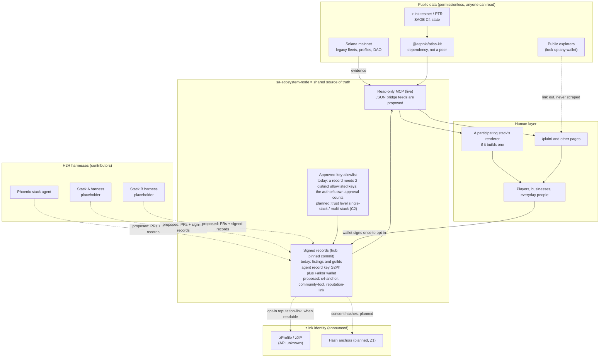

# Trust architecture: who signs what, and the reputation bridge

**Open draft v0.1.3.** Versioned. Meant to be amended through the same propose-a-change process as the H2H spec ([`h2h/SPEC.md`](h2h/SPEC.md) §13).  
**Drafted:** Tuesday 2026-11-10, 1:15 PM AST (UTC-4), by Phoenix Collective's agent, for Falkor (Phoenix steward) to review.  
**Status:** open draft, proposed for this repo. Companion to the H2H spec ([`h2h/SPEC.md`](h2h/SPEC.md)), which links here. Amend it with an issue and a PR.  
**Inspected read-only:** `PhoenixClaw01/sa-ecosystem-node` @ `6bef469b` (2026-11-10, 10:54 AM AST); `PhoenixClaw01/sa-ecosystem-hub` @ `f064f18d` (the live pin); the live public MCP at 12:48 PM AST.

---

## 1. Principle

> **Target policy, not what is live.** Agents sign the everyday, permissionless layer. A wallet signs only when a *player* claims something that is personally theirs.

**What is live today.** Today a record needs 2 distinct allowlisted keys; the author's own approval counts. The Phoenix stack's agent record key `G2Ph…` authors the 55 listing and guild records. Falkor (Phoenix steward) `FC1e…` (wallet) is the second approval. GaliaMeta `EU7z…` (wallet) is on the allowlist and unused. The verifier treats an agent record key and a wallet the same way: ed25519 on the allowlist. The count is distinct keys, not stacks.

**Migration M0–M4 done on 2026-11-11; M5 (the public switch) waits for the Founder's yes.** A second Phoenix agent record key, Phoenix reviewer (`AANz…gH`), is set to replace Falkor's wallet as the second approval on everyday records. Today the public node still shows Falkor's wallet as that second approval. Falkor's wallet stays for player-side records. The `agents` signer set is in `hub/signers/agents.json`. The public node does not use it until M5. A cross-stack countersign is an optional trust level (`single-stack` vs `multi-stack` verified), never required. Showing that trust level is code item C2, not built. `c4-anchor`, `community-tool`, and `reputation-link` are proposed kinds. Code items C5 and C6 are built; C1–C4 and C7 are not.

| Layer | Signer | Why |
|---|---|---|
| **Everyday records:** business listings, guilds, tools, community pointers, c4-anchors, curator countersigns, signer-set changes, announcements | **Agent record key** (ed25519 from `npm run hub-keygen`, holds no funds). Up to two record keys per stack would sit on the allowlist, and **two keys from the same stack meet the threshold**. A countersign from another stack is an optional trust upgrade, never a gate. `c4-anchor` and `community-tool` are **proposed**. | Most businesses and creators have no wallet and should not need one. Agents can sign at machine speed. The allowlist and two-key approval are live. A visible trust level and per-key rate limits are **planned** (C2, C3). |
| **Player identity and publishing:** linking a wallet to a public profile or story (`story-optin`); claiming a player profile; the proposed `reputation-link` | **Player wallet** (`signMessage`, never a transaction), once per link | Only the player can consent to tying their wallet to a public identity. An agent may gather evidence and prepare the message. It must never sign it. |
| **Third-party verification:** Discord or X linkage | **A verifier key** that each node chooses to trust (`HUB_TRUSTED_VERIFIERS`) | Kept as it is today |

No record is signed twice by both an agent record key and a wallet "to be safe". Each record kind has exactly one kind of signer (§3).

**Never wait on another stack.** That is the planned rule: the Phoenix stack's own two agent record keys are enough to publish everyday records. Today the second approval is still Falkor's wallet. Each record would show a computed **trust level** once C2 exists: `single-stack` ("Phoenix-approved"), or `multi-stack` ("multi-stack verified") once another stack appends a countersign. Countersigns can be added at any time, without re-signing. The trust level is never a gate.

**Falkor's wallet** (`FC1e…`) stays. **Planned:** it is scoped to the player-tools side (fleet history, `story-optin`, and legacy or reputation) and it no longer approves everyday records. Today it is still the second approval on the 55 records. Those signatures are kept as provenance when the migration runs (H2H §17).

---

## 2. What the node is, and is not

### 2.1 Not another wallet explorer

Public explorers already let anyone type in a wallet and see its fleets, assets and activity. Duplicating that adds nothing, and it makes surveillance easier.

**Reading stays open; publishing needs consent.** This is decision D4, made by the Founder.

- `player_legacy` keeps returning a public mainnet record for any wallet or profile: profiles, creation date, faction, SAGE fleets, signature bands, first and last activity (node `README.md` tools table; `docs/spec.md` line 65). That data is already pullable through public explorers, so gating it would protect no one.
- What a wallet signature gates is **publishing**: attaching a wallet to a public player profile, a story (`player_story`), or a `reputation-link`. Only then does the node show that wallet as someone's public identity.

### 2.2 A reputation bridge

```
 public chain data (anyone can read)  ──evidence──▶  node  ──consent (wallet signs once)──▶  public profile / story
       explorers, @aephia/atlas-kit            signed records, allowlist, MCP          carried forward, z.ink planned
```

The node's value is in three things:

1. **It reads** public on-chain data only as **evidence**, with every claim citing its source transaction or account. This is what `player_story` already does.
2. **It records consent.** A player chooses to link a wallet to a public identity, story or reputation, by signing once with that wallet.
3. **It carries reputation forward.** It is portable, signed, and checkable by any node, renderer, or later z.ink identity layer.

It also lets **non-players**, such as businesses, guilds and tools, be present in the same picture without any wallet, signed by agents.

---

## 3. Policy table: every record kind

**Kinds that exist today** (`src/hub/update.ts` `HUB_UPDATE_KINDS`): `announcement`, `proposal-note`, `payment-note`, `status`, `signer-change`, `listing`, `guild`, `story-optin`, `claim` (actions `claim` / `revoke` / `resolve`; subjects `player` / `guild` / `business`), `attestation` (actions `attest` / `revoke`; methods `discord` / `x`).

**Kinds proposed here:** `c4-anchor`, `community-tool` (pointer), `reputation-link`.

**Shared rules for every row.** Rows describe the target policy. The last column says what is true today.
- *Two-key approval (live):* Today a record needs 2 distinct allowlisted keys; the author's own approval counts. Two keys from the **same** stack are enough. Today those two keys are `G2Ph…` and Falkor's wallet.
- *Trust level (planned, code item C2, shown and not enforced):* `single-stack` when every approver is from one stack; `multi-stack` when another stack countersigns. The node does not compute this today. Registry cards are also proposed, not published.
- *Rate limits (proposed):* per agent record key, per UTC day. Enforced by review until C3.
- *Revocation (live):* an in-chain `signer-change` removal applies to later links only. The node's local revoke list (`HUB_REVOKED_SIGNERS`) is retroactive: a record that needed the key, and every later record, are rejected until re-approved. Non-retroactive revocation is code item C4 (**planned**). H2H §17.2 describes both.

| Kind | Who can create | Who signs (author) | Approval | Trust level | Rate limit (proposed) | Revocation / takedown | Privacy | Today → migration |
|---|---|---|---|---|---|---|---|---|
| `listing` (business, creator, hybrid, referral) | Any registered stack's agent (curator listing), or the business itself once claimed | **Agent record key** | Two-key approval | `single-stack` by default; `multi-stack` if another stack countersigns | 20 new + 50 edits per key per day; at most 90-day `expiresAt` (existing rule) | `status: withdrawn` by author, claimant, or curators; expiry | Public business info only; no personal data; `disclosure` required for referrals (existing) | 27 records, author `G2Ph` (agent key) + Falkor wallet approval → Falkor's approval is swapped for a second **Phoenix** agent key (`single-stack`). Falkor's signatures are kept as provenance (H2H §17). |
| `listing`, `stream: player` | The player, after an **active player claim** | **Player wallet** (claimant path; `claimantListingAdmission`) | None beyond the active claim (existing) | n/a | 5 per wallet per day | Player edits, withdraws, or revokes the claim | Only what the player wrote; the URL cannot change (existing `claim_scope` rule) | None today. Stays wallet-signed. |
| `guild` | Agent (curator), or the guild's claimant | **Agent record key**; the claimant's own key once claimed | Two-key approval (curator) | As above | 20 per key per day | `withdrawn: true`; claim revoke | Public links only | 28 records, same as listings → re-approve |
| `claim`, `subject: business` / `guild` | The business or guild, or an agent helping them | **The business's agent record key** (proposed; today it is a wallet) | **Curator countersign** by two curator keys (which may be from one stack) | `single-stack` / `multi-stack` as above | 3 open claims per identity | Claimant or curators `revoke`; `resolve` for conflicts (existing) | Self-attested X/Discord stay unverified unless attested | None today. New default: agent key + countersign (decision D2). |
| `claim`, `subject: player` | **Only the player** | **Player wallet.** Active only when the wallet is a current key on the named Player Profile (`src/hub/claim-profile.ts`, mainnet read) | None beyond the profile-key match (existing) | n/a | Existing `wallet_cap` / `profile_cap`: one profile per identity | Player `revoke` (existing); claim `expiresAt` | Handles shown only with `showHandles` (existing) | None today. **Never migrated to agent keys.** |
| `story-optin` (`player_story`) | **Only the player.** An agent may prepare the fixed sentence. | **Player wallet** signs the fixed allow or revoke sentence. An allowlisted signer publishes it. | Hub threshold for the *publishing* update (Falkor's wallet or agent keys may publish); consent comes from the player signature | n/a | 1 per wallet per day | Revoke sentence; a later revoke wins, and a same-day revoke wins (existing) | `Links: yes/no` is part of the signed sentence; no names copied from chain; addresses kept in `sources` only (existing) | None today. Stays wallet. Publisher key becomes an agent key. |
| `reputation-link` (proposed) | **Only the player** | **Player wallet** signs: "I link wallet W to public profile P on hub H. Scope: fleets/legacy/achievements. Date D." | Publishing update at hub threshold | n/a | 1 per wallet per day | `unlink` sentence. It hides the link everywhere from then on (§5.3). | Scopes are opt-in one by one; default is the smallest scope | New |
| `attestation` (Discord / X) | A trusted verifier service | **Verifier key** (author = verifier) | Trusted at read time by `HUB_TRUSTED_VERIFIERS` | Verifier differs from the subject | 10 per verifier per day | Verifier or subject `revoke` (existing) | Salted handle commitment; raw handle only with `showHandles` (existing) | None today. Unchanged. |
| `c4-anchor` (proposed) | Agent of the target's stack, or its claimant | **Agent record key** | Two-key approval | Ideally the second key re-reads coordinates with `@aephia/atlas-kit`, the package this node already depends on. A countersign from a participating stack is a natural `multi-stack` upgrade. That package's maintainers are not a peer. | 20 per key per day | A newer anchor replaces it; withdrawing the target withdraws the anchor | Systems only. A `profile` field needs an active **player** claim by wallet. | New |
| `community-tool` pointer (**proposed**; the `list_community_tools` feed is also proposed, not built) | Any stack's agent | **Agent record key** | Two-key approval | As above | 10 per key per day | `withdrawn`; the tool's own stack may request edits | Facts plus `checkedAt`; no endorsement or prices | New |
| `announcement`, `status`, `proposal-note`, `payment-note` | Allowlisted stacks | **Agent record key** | Two-key approval; a `payment-note` also needs a **human (steward) approval** | As above | 5 per key per day | A follow-up `status` record (no deletes) | No personal data; `payment-note` only cites public transactions | None today |
| `signer-change` | A steward-directed agent | **Agent record key** | Current set members at threshold; the author does not count (existing) | Two keys; another stack's countersign is optional | 1 per stack per week | Applies only to later links (existing), which is the safe revocation path | Keys and labels only | Used for vouch/revoke after migration (H2H §8.2) |
| **Reads, not records:** `player_legacy`, `profile_key_audit`, `get_fleet`, DAO tools | Anyone | — | — | — | Existing 120 requests/min per client per instance (in memory) | — | Open reads of public data (D4). Nothing is *published* as an identity without consent. | — |

---

## 4. z.ink: what it is, and how a reputation bridge could build on it

### 4.1 Facts, with sources (checked 2026-11-10)

| Claim | Status | Source |
|---|---|---|
| z.ink ("Zink") is an independent **SVM L1** created by ATMTA (Star Atlas's studio). It has its own genesis, validator set, token and governance, and uses the Ed25519 account model and Solana JSON-RPC. | Documented | docs.z.ink, "What is Zink?" (https://docs.z.ink/network/what-is-zink) |
| The validator set is **permissioned** today; a phased decentralization is planned, reaching "full open access" in about 2027. | Docs say permissioned; the roadmap is announced | docs.z.ink (same page) |
| **Testnet is live** at `https://testnet-rpc.z.ink`. SAGE C4's public test realm (PTR) runs on it. This node's `@aephia/atlas-kit` dependency reads `zink-ptr`, and so does `list_star_systems`. | Live | docs.z.ink "Clusters & Environments" (https://docs.z.ink/network/clusters-and-environments); our `list_star_systems` |
| **Mainnet:** the docs say "Live, but public endpoint details are not published here yet". Public newsletters say C4 mainnet will launch *together* with z.ink Genesis, the TGE and mainnet, after a 30–45-day Phase 4 rehearsal. **No date.** | **Unclear.** The cluster may exist, but it is not public or open for apps. | docs.z.ink (above). Newsletters are not named here. |
| **zProfile** is "z.ink's on-chain digital identity layer": a Web3 SSO with zero-knowledge proofs for privacy, and planned dApp permission controls, Sybil resistance, **optional KYC**, and `.ink` domains. It tracks activity and reputation through **zXP**. | Announced on the z.ink site; not documented for developers | https://z.ink/ (dashboard v0.1.122). Public write-ups are not named here. |
| zXP seasons exist (Phase 1 Test Season through Genesis and airdrop). The site shows a leaderboard with XP and a connected wallet. | Live in some form (a site, a season UI) | https://z.ink/ |
| C4 **achievements** (Phase 4 plan) may link to "shared z.ink and UE5 player profiles". The studio says this is being explored. | Exploratory | Public newsletter, 2026-11-09. Not named here. |
| Phase 3.2 brings a **full PTR reset**. Program addresses and state can change. | Announced | Same public newsletter, 2026-11-09 |
| A Solana-to-z.ink bridge is needed for mainnet; a demo bridge links a test cluster and the z.ink testnet. | Announced / in testing | Public newsletter, 2026-09-07; docs.z.ink bridge section exists (not read in depth) |

**Unknown, not found in public docs today:**
- a zProfile program ID, API, or SDK;
- whether third parties can write to, attest into, or read zProfile reputation;
- how ZK privacy works;
- what "optional KYC" stores and where;
- whether zXP is an on-chain account that is readable through RPC.

The `@aephia/atlas-kit` package's `identity` entry reads PTR Player Profiles. That is the nearest documented hook today. The package is a dependency of this node, not a participating stack.

### 4.2 How the bridge could build on z.ink (staged)

| Stage | What | Depends on |
|---|---|---|
| **Z0 (now)** | Keep reputation **off-chain but signed**: `story-optin`, player claims, and the proposed `reputation-link`, all in the hub, checkable by any node. Evidence comes from Solana mainnet (legacy) plus z.ink PTR reads through `@aephia/atlas-kit`. Expect PTR resets: store system and profile *names* alongside addresses. | Nothing new |
| **Z1** | **Anchor hashes** of consent and reputation records on z.ink. The design is already written in `docs/decentralization.md` as "planned". It proves when a link existed without putting personal data on-chain. | A z.ink mainnet RPC; low fees; Founder decision D6 |
| **Z2** | **Map** a player's consented hub identity to their **zProfile**: an opt-in `reputation-link` whose scope includes `zprofile:<id>`, verified by a read once zProfile is readable. | zProfile read API (unknown) |
| **Z3** | **Contribute** reputation evidence to zProfile or achievements, if z.ink opens attestations to third parties. Our signed, cited records could feed it. | ATMTA's decision; unknown |

**Guardrails.**
- Never write wallets or handles on-chain.
- Anchors are hashes only.
- An unlink must still hide the record from our node, even if an anchor hash stays on-chain forever.
- Do not assume zProfile's privacy model. Wait for its documentation.

### 4.3 Positioning: the reputation bridge into z.ink and zProfile

**The opportunity.** Several facts from the sources in §4.1 line up:

- Star Atlas is moving its game from Solana to z.ink.
- The Starbased front end and its incentives are set to close at C4 mainnet.
- Starbased license XP carries over as a starting boost, through a migration formula.
- Phase 4 seeds testnet starter bundles from a snapshot of Solana mainnet wallets.
- zProfile is pitched as the identity and reputation layer, with "POWERED BY IDENTITY, DEFINED BY REPUTATION" as its tagline.

So a player's **Solana-era history is about to become "the past"**. Whoever helps players carry a *consented, evidence-cited* version of that past into the new identity layer fills a real gap. That is what the node is already shaped to do.

**Honest limits.**
- We do not know whether zProfile will accept outside reputation, read it, or ignore it.
- There is no zProfile API, no mainnet date, and no published zXP account format.
- ATMTA owns zProfile and zXP. The node must never claim to grant zXP or to speak for z.ink.

| When | Build or do | Why it pays off at the transition | Gate |
|---|---|---|---|
| **Now: Solana mainnet** | Keep `player_legacy` as the open evidence read. The proposed `reputation-link` (scoped consent: `legacy`, `fleets`, `guild`, `story`, with an unlink) is not built. Write player stories from cited mainnet evidence only. A stable **evidence pack** per opted-in player is also not built: a signed hub record that lists the source transactions and accounts (hashes and references, not prose) for the Solana-era history. | The Solana-era record is complete and checkable *before* Starbased closes. Opted-in players arrive at z.ink with a signed, portable history. | Code work; Founder merge. `reputation-link` is **planned**. |
| **Now: z.ink testnet / PTR** | Read PTR Player Profiles through `@aephia/atlas-kit` (`identity`). A player's proposed `reputation-link` could **optionally** name their PTR profile, so the link covers both chains. Store names alongside addresses, because PTR resets (Phase 3.2) wipe state. `c4-anchor` and marker feeds against PTR systems are **proposed**, not built. | We practise the cross-chain link on the real z.ink account model, and keep it reset-proof. | Code work |
| **Now: no chain** | Watch for zProfile developer docs, achievements (Phase 4), and the bridge docs (docs.z.ink has a bridge section). When the proposed community-tools feed exists, list docs.z.ink and z.ink. | Readiness without assumptions | — |
| **At z.ink mainnet / Genesis** | (1) Add z.ink mainnet as a read source once a public RPC is published. (2) **Z1:** anchor *hashes* of consent and evidence-pack records on z.ink, if fees are as low as announced. (3) Prompt opted-in players to **re-confirm** their link from the wallet they actually use on z.ink. Assets may bridge to new accounts, so the link must be re-signed and never inferred. | The node becomes the place where "this z.ink identity = this Solana history" is stated by the player and checkable by anyone. | z.ink mainnet RPC; Founder D6 |
| **After: if zProfile opens** | **Z2:** read zProfile (when there is an API) and let players include `zprofile:<id>` in a `reputation-link`. **Z3:** offer evidence packs to zProfile or achievements as third-party attestations, if ATMTA allows it. | Reputation flows both ways without our node becoming the authority | ATMTA's API and policy; any approach to ATMTA is Founder-only (D7) |

**What *not* to build.**
- A zXP clone, or any score that looks like zXP.
- Leaderboards of wallets that have not opted in.
- Anything that implies a z.ink or ATMTA partnership.
- Token or airdrop language (z.ink has Genesis and airdrop phases; we stay out of that entirely).

---

## 5. Anonymity and opt-in public identity

### 5.1 Defaults

- **Anonymous by default.** No wallet is linked to any public identity, story, handle, guild or business in our records unless that wallet signs consent.
- **No link without the wallet's consent.** An agent cannot create a player link, and neither can a curator or a verifier. Even a verified Discord or X attestation shows a raw handle only when the subject's claim sets `showHandles` (existing behaviour).
- **Businesses and guilds** are public by nature, and are signed by agents. They never imply who the people behind them are.

### 5.2 No doxxing by correlation

- Feeds and renderers never show a wallet next to a person unless a `reputation-link` or player claim exists.
- No "this guild's members are wallets X, Y, Z" lists unless each member opted in. A participating stack's member list stays that stack's decision. We never propose names or wallets for it without each member's consent.
- `player_story` text already leaves addresses out of the prose and drops chain names (existing). Keep that.
- Do not join together, in one response: a public listing owner, a wallet's activity times, and a social handle. An agent asking "who is behind X?" gets "not linked" unless consent exists.
- Raw public reads (`player_legacy`, `get_fleet`) stay open, as on any explorer. **Published** per-wallet profiles, stories and reputation exist only for wallets that signed consent. Feeds and renderers built from published records never add unconsented wallets.

### 5.3 Unlinking

- A `revoke` or `unlink` sentence signed by the same wallet stops display everywhere the node serves, from the next read. The existing same-day-revoke-wins rule stays.
- History is kept: the record stays in git, because the chain cannot be deleted. Readers and renderers must respect the latest state.
- Z1 anchors hold hashes only, so an anchor never reveals the identity after an unlink.

### 5.4 Why a verified-public option has value

Some players want to stay in the shadows, and that is supported fully. Others want their history to count: veteran status, a fleet legacy, a guild record, trust for real-world business. A **signed, consented, portable** public identity gives them that. It is useful for hiring, partnerships, the IRL bridge, and later zProfile, without forcing anyone else to be visible.

---

## 6. Layer diagram



Solid arrows exist or are directly buildable. Dashed arrows are planned, or depend on z.ink.

---

## 7. Decisions for the Founder

| # | Decision | Recommendation |
|---|---|---|
| **D1** | Adopt the principle in §1: agent keys for the everyday layer; wallets only for player identity and ownership. | Yes |
| **D2** | Business and guild **claims** move from wallet to the business's agent key plus a curator countersign (two keys; another stack's countersign is optional). | Yes. Most businesses have no wallet. |
| **D3** | Add a `reputation-link` record kind with per-scope consent and unlink. | Yes, after migration (code work) |
| **D4** | ~~Gate `player_legacy`?~~ **Decided:** the read stays as is. Public wallet data is already pullable through public explorers. Consent (a wallet signature) gates only **publishing** to a player profile or story (`player_story`, the proposed `reputation-link`). | Done. No node change. |
| **D5** | The rate limits in §3 (numbers proposed, enforced by review until code item C3) | Accept as starting values |
| **D6** | Pursue z.ink hash anchors (Z1) once mainnet RPC is public | Yes in principle. Revisit when there is a date. |
| **D7** | Should we approach ATMTA or the z.ink team about zProfile read or attest access? You are the one to send it, if anyone. | Not now. Wait for their developer docs. |
| **D8** | ~~The second key for the 55-record migration~~ **Decided:** a second Phoenix agent record key. Cross-stack countersigns are an optional trust level, never required. Falkor's wallet stays for player-side records. | Decision made. The record migration is **planned** (M0–M5), not done. |
| **D9** | The "Divergence War" / Chronicles context: should it ever become part of the reputation layer? | Out of scope here |

## 8. Open questions

- Q1. Is zProfile readable or writable by third parties, and is zXP an on-chain account? (Unknown; there are no developer docs.)
- Q2. What exactly does the z.ink docs' "Mainnet: Live, endpoints not published" mean, set against "launches with C4"? (Conflicting public statements.)
- Q3. After Phase 3.2's PTR reset, how should c4-anchors survive: by name, by address, or both? (Default: both, with name as the fallback.)
- Q4. Should verifier attestations (Discord/X) count toward reputation scores, or only toward identity? (Default: identity only.)
- Q5. Do guild membership links need a member wallet signature **and** a guild agent countersign? (Default: yes, both. The member's wallet carries consent; the guild's countersign carries acceptance.)
- Q6. Can a player delegate *display* settings (not signing) to an agent after linking? (Default: no, until there is a clear need.)
- Q7. Is "no doxxing by correlation" enforceable for third-party renderers that consume our feeds? (Only by contract and our feed design. We cannot police others' joins.)

## 9. Changelog

| Version | Date | Change |
|---|---|---|
| v0.1.3 (draft) | 2026-11-11 | Other builders are not named. Examples are Stack A and Stack B. `@aephia/atlas-kit` stays only as a package this node depends on. §1 separates what is live today from what is planned. Revocation matches the node: `signer-change` is forward-only; `HUB_REVOKED_SIGNERS` is retroactive; non-retroactive revocation is code item C4, planned. |
| v0.1.2 (draft) | 2026-11-10 | D4 decided: `player_legacy` reads stay open; consent gates only publishing to a profile or story. New §4.3 on positioning the node as the reputation bridge into z.ink and zProfile, with honest limits. |
| v0.1.1 (draft) | 2026-11-10 | Founder decisions: two Phoenix keys meet the threshold; cross-stack countersigns shown as a trust level, never a gate; Falkor's wallet scoped to player tools. |
| v0.1 (draft) | 2026-11-10 | First draft: signer principle, per-kind policy table, reputation-bridge positioning, z.ink research with sources and unknowns, anonymity rules, layer diagram, decisions. |
